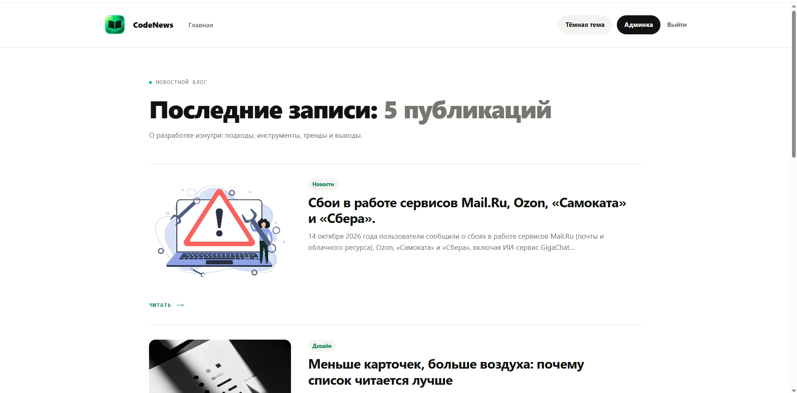
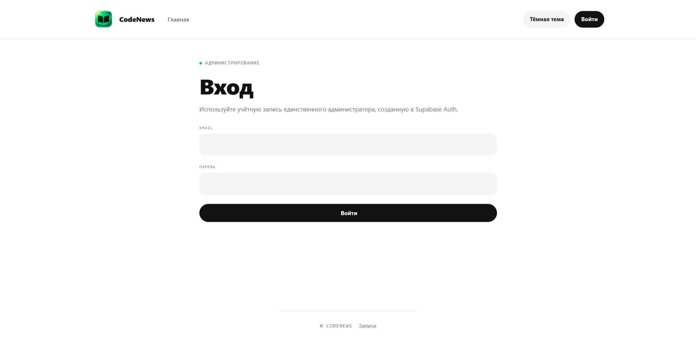
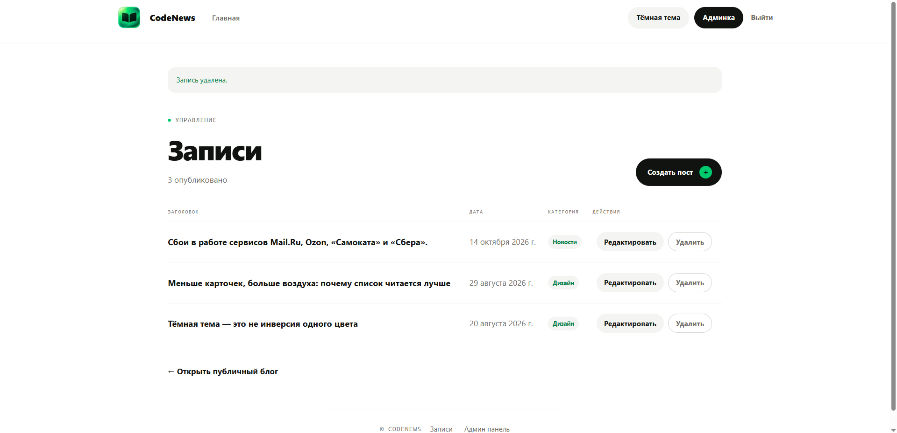

# 📰 CodeNews — Новостной блог о технологиях и программировании

**CodeNews** — Новостное веб-приложение для публикации и чтения статей о технологиях и программировании. Проект создан с использованием Next.js, TypeScript и Supabase и включает публичную часть блога и панель администратора для управления публикациями.

Проект создан в образовательных и практических целях для изучения современной full-stack веб-разработки.

🌐 **Демо:** [code-news-chi.vercel.app](https://code-news-chi.vercel.app/)

📦 **Репозиторий:** [GitHub](https://github.com/Superpnz/codeNews)

## 📸 Скриншоты

### Главная страница



### Страница статьи


### Авторизация



### Панель администратора



## ✨ Возможности

- 📚 Просмотр списка статей и отдельных публикаций.
- 🔐 Авторизация администратора.
- ✍️ Создание и редактирование статей.
- 🗑️ Удаление публикаций.
- 🗄️ Хранение данных с помощью Supabase.
- 🌓 Переключение светлой и тёмной темы.
- 📱 Адаптивный интерфейс для разных размеров экрана.
- 🚀 Публикация приложения через Vercel.

## 🛠️ Технологии и инструменты

### Frontend

- **[Next.js 16](https://nextjs.org/)** — основной фреймворк приложения. Используется App Router для организации страниц, динамических маршрутов и серверной логики.
- **[React 19](https://react.dev/)** — создание интерактивного пользовательского интерфейса на основе компонентов.
- **[TypeScript 5](https://www.typescriptlang.org/)** — статическая типизация, описание моделей данных и повышение надёжности кода.
- **CSS** — оформление страниц, адаптивная вёрстка и стилизация компонентов.
- **[next-themes](https://github.com/pacocoursey/next-themes)** — управление темами оформления, включая переключение светлой и тёмной темы.
- **[React Compiler](https://react.dev/learn/react-compiler)** — инструмент оптимизации React-компонентов на этапе компиляции.

### Backend и работа с данными

- **[Supabase](https://supabase.com/)** — платформа на основе PostgreSQL для хранения публикаций и работы с данными блога.
- **[@supabase/supabase-js](https://github.com/supabase/supabase-js)** — взаимодействие с Supabase через JavaScript-клиент.
- **[@supabase/ssr](https://github.com/supabase/ssr)** — интеграция Supabase с серверным рендерингом и управление клиентами в серверном и браузерном окружении.
- **[Zod 4](https://zod.dev/)** — валидация входных данных и проверка соответствия данных заданным схемам.
- **Next.js Server Actions** — выполнение серверных операций, в том числе связанных с управлением публикациями.

### Качество кода и разработка

- **[ESLint 9](https://eslint.org/)** — статический анализ кода и поиск потенциальных проблем.
- **[eslint-config-next](https://nextjs.org/docs/app/api-reference/config/eslint)** — правила ESLint для Next.js.
- **[@types/react](https://www.npmjs.com/package/@types/react)** и **@types/react-dom** — типы TypeScript для React и React DOM.
- **@types/node** — типы Node.js для разработки на TypeScript.
- **[npm](https://www.npmjs.com/)** — управление зависимостями и запуск команд проекта.
- **[Git](https://git-scm.com/)** и **[GitHub](https://github.com/)** — контроль версий и хранение исходного кода.
- **[Vercel](https://vercel.com/)** — развёртывание приложения и публикация обновлений.

### Основные инструменты проекта

| Команда | Назначение |
|---|---|
| `npm run dev` | Запуск локального сервера разработки |
| `npm run build` | Сборка production-версии |
| `npm run start` | Запуск собранного приложения |
| `npm run lint` | Проверка кода с помощью ESLint |

## 🏗️ Структура проекта

```text
codeNews/
├── app/
│   ├── admin/
│   │   ├── [id]/
│   │   │   └── edit/
│   │   │       └── page.tsx       # Страница редактирования статьи
│   │   ├── new/
│   │   │   └── page.tsx           # Страница создания статьи
│   │   ├── actions.ts             # Серверные действия администратора
│   │   └── page.tsx               # Панель управления публикациями
│   ├── login/
│   │   ├── actions.ts             # Серверные действия авторизации
│   │   └── page.tsx               # Страница входа
│   ├── posts/
│   │   └── [id]/
│   │       └── page.tsx           # Страница отдельной статьи
│   ├── globals.css                # Глобальные стили приложения
│   ├── layout.tsx                 # Корневой макет приложения
│   ├── page.tsx                   # Главная страница блога
│   └── post-list.css              # Стили списка публикаций
│
├── components/
│   ├── DeletePostButton.tsx       # Кнопка удаления публикации
│   ├── Footer.tsx                 # Подвал сайта
│   ├── Header.tsx                 # Шапка сайта и навигация
│   ├── LoginForm.tsx              # Форма авторизации
│   ├── PostCover.tsx              # Обложка публикации
│   ├── PostForm.tsx               # Форма создания и редактирования
│   ├── PostList.tsx               # Список статей
│   └── ThemeToggle.tsx            # Переключатель темы оформления
│
├── data/
│   ├── posts.ts                   # Работа с данными публикаций
│   └── seed.sql                   # SQL-скрипт начальных данных
│
├── lib/
│   ├── supabase/
│   │   ├── config.ts              # Конфигурация Supabase
│   │   ├── public.ts              # Клиент Supabase для публичных запросов
│   │   ├── server.ts              # Серверный клиент Supabase
│   │   └── proxy.ts               # Обновление сессии Supabase
│   ├── auth.ts                    # Проверка авторизации и прав администратора
│   ├── categories.ts              # Список категорий публикаций
│   ├── format.ts                  # Форматирование данных
│   ├── posts.ts                   # Получение списка и отдельных статей
│   └── validation.ts              # Валидация данных с помощью Zod
│
├── public/
│   ├── brand/                     # Изображения и ресурсы бренда
│   └── favicon/                   # Иконки сайта
│
├── screenshots/
│   ├── main-page.png              # Скриншот главной страницы
│   ├── post-page.png              # Скриншот страницы статьи
│   ├── login-page.png             # Скриншот страницы входа
│   └── admin-panel.png            # Скриншот панели администратора
│
├── types/
│   └── blog.ts                    # TypeScript-типы данных блога
│
├── proxy.ts                       # Обработка входящих запросов
├── .prettierrc.json               # Настройки форматирования Prettier
├── package.json                  # Зависимости и команды npm
├── package-lock.json             # Зафиксированные версии зависимостей
├── .gitignore                    # Исключения для Git
└── README.md                     # Документация проекта
```

## ⚙️ Установка и запуск

### 1. Клонирование репозитория

```bash
git clone https://github.com/Superpnz/codeNews.git
cd codeNews
```

### 2. Установка зависимостей

```bash
npm install
```

### 3. Настройка окружения

Создай файл `.env.local` в корне проекта и укажи данные своего проекта Supabase:

```env
NEXT_PUBLIC_SUPABASE_URL=your_supabase_url
NEXT_PUBLIC_SUPABASE_PUBLISHABLE_KEY=your_supabase_publishable_key
SUPABASE_ADMIN_ID=your_admin_id
```

Для работы приложения необходим настроенный проект Supabase с таблицей публикаций и пользователем-администратором.

### 4. Запуск приложения

```bash
npm run dev
```

Открой [http://localhost:3000](http://localhost:3000).

### Production-сборка

```bash
npm run build
npm run start
```

## 🔒 Безопасность

- Секретные настройки хранятся в переменных окружения.
- Операции управления публикациями доступны через административную часть приложения.
- Права доступа к данным должны дополнительно контролироваться политиками Supabase RLS и серверной проверкой авторизации.


## 👨‍💻 Автор

**Maxim Anikeev (Superpnz)**

- GitHub: [@Superpnz](https://github.com/Superpnz)

---

⭐ Если проект оказался полезным или интересным, поставь репозиторию звезду!
